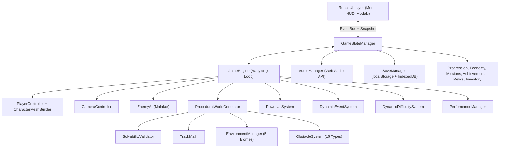

# ARCHITECTURE — RELIC RUSH: LOST KINGDOMS

## 1. Panoramica Architetturale
Il progetto adotta un'architettura modulare **Event-Driven + Deterministic Simulation**, separando rigorosamente:
1. **Motore 3D & Loop di Gioco (`src/engine/`, `src/world/`, `src/entities/`)**: Esegue il rendering WebGL2 via Babylon.js, la fisica deterministica, la generazione procedurale con pool di segmenti e il controllo frame-by-frame del protagonista e del nemico.
2. **Sistemi di Dominio (`src/systems/`, `src/core/`)**: Gestiscono stato di gioco, progressione, economia, missioni, achievement, reliquie, eventi dinamici, difficoltà dinamica e persistenza.
3. **Audio Procedurale (`src/audio/`)**: Sintetizzatore Web Audio API adattivo senza dipendenza da asset esterni.
4. **UI Reattiva (`src/ui/`)**: Interfaccia React 18 sovrapposta al canvas 3D, sincronizzata tramite `EventBus` con aggiornamenti controllati per mantenere 60 FPS stabili.

---

## 2. Sistema di Coordinate Procedurali, Curve a 90° e Bivi

Per rendere possibili infinite curve di 90° e bivi a T senza imprecisioni numeriche o compenetrazioni:
- Ogni `TrackSegment` possiede:
  - `id`: identificativo univoco.
  - `origin`: punto iniziale `(x, y, z)` nel mondo 3D.
  - `direction`: direzione cardinale (`0: +Z`, `1: +X`, `2: -Z`, `3: -X`).
  - `length`: lunghezza longitudinale del segmento (es. `24m`, `28m`, `32m`).
  - `type`: `'straight' | 'bridge' | 'tunnel' | 'elevated' | 'narrow' | 'turn_left' | 'turn_right' | 'fork_t'`.
  - `nextSegmentId` (e `altNextSegmentId` per i bivi `fork_t`).
- `TrackMath.localToWorld(origin, direction, localZ, laneOffset, localY)` mappa istantaneamente qualsiasi posizione sul segmento nelle coordinate 3D globali e restituisce il vettore `forward` e `right`.
- Quando `player.localZ` supera `segment.length` su un segmento dritto, il giocatore transita senza soluzione di continuità sul segmento successivo conservando il residuo di `localZ`.
- Sui segmenti `turn_left`, `turn_right` e `fork_t`, l'ultima porzione (`localZ >= length - 10`) attiva la **Zona di Svolta**:
  - Se il giocatore invia un input sinistra/destra compatibile (anche tramite Input Buffer nei 220ms precedenti), il personaggio svolta istantaneamente o al centro dell'incrocio nel nuovo corridoio.
  - Nei bivi (`fork_t`), il giocatore può scegliere liberamente sinistra o destra, e il ramo non scelto viene poi riciclato una volta superato l'incrocio.

---

## 3. Garanzia di Superabilità (`SolvabilityValidator`)

Ogni segmento generato da `ProceduralWorldGenerator` non inserisce ostacoli arbitrariamente, ma passa attraverso `SolvabilityValidator.validateAndAdjust()`:
1. **Zona Sicura in Curva**: Gli ultimi `8m` di qualsiasi segmento di svolta/bivio e i primi `6m` del segmento immediatamente successivo sono forzati privi di ostacoli letali.
2. **Spazio Temporale Minimo**: La distanza tra ostacoli consecutivi deve rispettare:
   `minGapZ = speed * (recoveryTime + reactionTime)` (dove `reactionTime >= 0.28s` + eventuale cambio corsia `0.18s`).
3. **Passaggio Garantito per Slice**: Per ogni fascia `z` (`bucket` di `2m`), almeno una delle 3 corsie deve risultare attraversabile con corsa, salto (`JUMP`) o scivolata (`SLIDE`). I tratti `narrow_path` bloccano le corsie esterne (`-1` e `+1`) lasciando aperta la corsia centrale (`0`) senza ostacoli simultanei non saltabili.

---

## 4. Object Pooling e Gestione Risorse GPU
- I segmenti superati (`distanceFromPlayer > 2` segmenti alle spalle) vengono rimossi dalla scena attiva e ripuliti (`dispose` delle mesh figlie dinamiche e riutilizzo di materiali condivisi per bioma tramite cache `MaterialCache` in `EnvironmentManager`).
- Le luci, il `DefaultRenderingPipeline` e le texture procedurali canvas (`512x512` con normal/bump map sintetiche) vengono create una sola volta all'avvio o al cambio bioma e riutilizzate su tutti i segmenti.
- `PerformanceManager` monitora gli FPS reali e regola dinamicamente `hardwareScalingLevel` oltre a governare i 4 preset grafici (`low`, `medium`, `high`, `ultra`).

---

## 5. Persistenza e Integrità Dati (`SaveManager`)
- **Storage Primario**: `localStorage` sotto chiave `relic_rush_save_v2` per accesso sincrono istantaneo all'avvio e salvataggio sicuro alla fine di ogni evento critico.
- **Backup Ridondante**: `IndexedDB` (`RelicRushDB`, store `saves`) aggiornato asincronamente ad ogni salvataggio.
- **Migrazione e Ripristino**:
  - Supporta la migrazione automatica da schema `v1` a `v2`.
  - Esegue validazione dei tipi e clamping dei campi numerici (contro dati corrotti o modificati parzialmente).
  - Deduplicazione delle ricompense riscosse (`claimedMissionIds`, `unlockedAchievements`, `claimedDailyCycle`).
  - Esportazione/Importazione JSON completa e reset sicuro con conferma.
